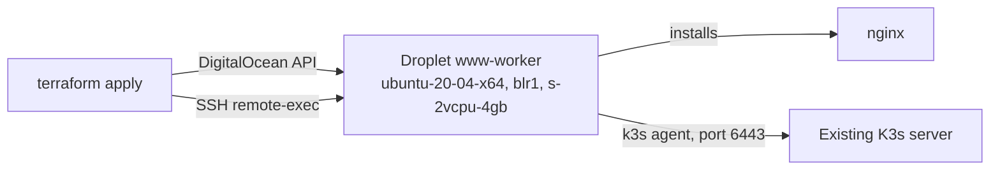

# terraform-rancher-digitalOcean-k3s-setup

Terraform configuration that creates a DigitalOcean droplet, installs nginx on it and joins it to an existing K3s cluster as a worker (agent) node.

## Overview

The only Terraform code lives in [`loadbalance/`](./loadbalance):

- [`provider.tf`](./loadbalance/provider.tf) configures the `digitalocean/digitalocean` provider (`~> 2.0`) and looks up an existing DigitalOcean SSH key named `terraform`.
- [` www-1.tf`](./loadbalance/%20www-1.tf) (the file name starts with a space) defines the `www-1` droplet, a `remote-exec` provisioner and the outputs.

The provisioner connects to the droplet as `root` over SSH, then runs `apt update`, installs and starts nginx, and installs the K3s agent with `K3S_URL`/`K3S_TOKEN` pointing at an existing K3s server on port 6443.

> Despite the repository name, no Rancher resources are defined in this repository. TODO: confirm whether Rancher is managed elsewhere.

## Architecture



## Prerequisites

- [Terraform](https://developer.hashicorp.com/terraform/downloads) (the committed state file was written by 1.9.5; the minimum required version is not pinned, TODO).
- A DigitalOcean personal access token.
- A DigitalOcean SSH key named `terraform` already registered in your account, and the matching private key on your machine.
- A reachable K3s server and its node join token.

## Quick start

```bash
cd loadbalance
terraform init
terraform plan  -var "do_token=$DO_PAT" -var "pvt_key=$HOME/.ssh/id_rsa"
terraform apply -var "do_token=$DO_PAT" -var "pvt_key=$HOME/.ssh/id_rsa"
```

`export DO_PAT="<your DigitalOcean token>"` first. The private key path above is an example; use the key that matches your `terraform` SSH key.

**Before applying:** the K3s server URL and join token are currently hardcoded inside the `remote-exec` command in ` www-1.tf`. Replace them with your own cluster's values (ideally by turning them into variables) and never commit a real token.

## Configuration

### Variables

| Name | Type | Default | Description |
|------|------|---------|-------------|
| `do_token` | `string` | none (required) | DigitalOcean API token |
| `pvt_key` | `string` | none (required) | Path to the SSH private key used by the provisioner |

### Hardcoded droplet settings (` www-1.tf`)

| Setting | Value |
|---------|-------|
| Name | `www-worker` |
| Image | `ubuntu-20-04-x64` |
| Region | `blr1` |
| Size | `s-2vcpu-4gb` |

### Outputs

| Name | Description |
|------|-------------|
| `worker_node_ip` | Public IP address of the K3s worker node |
| `worker_node_private_ip` | Private IP address of the K3s worker node |
| `worker_node_status` | Status of the worker node |
| `ssh_connection_command` | SSH command to connect to the worker node |

## Structure

```
.
├── README.md
└── loadbalance/
    ├── provider.tf      # provider, variables, SSH key data source
    └──  www-1.tf        # droplet, provisioner, outputs
```

## Troubleshooting

- `provider.tf` notes that an S3 backend is disabled, so state is local. Do not commit `terraform.tfstate` or `.terraform/`.
- SSH timeouts: the provisioner waits 2 minutes; check that `pvt_key` matches the `terraform` key in DigitalOcean.

## License

Released under the [MIT License](./LICENSE).

## Author

Umesh Khatiwada, https://github.com/umesh-khatiwada
